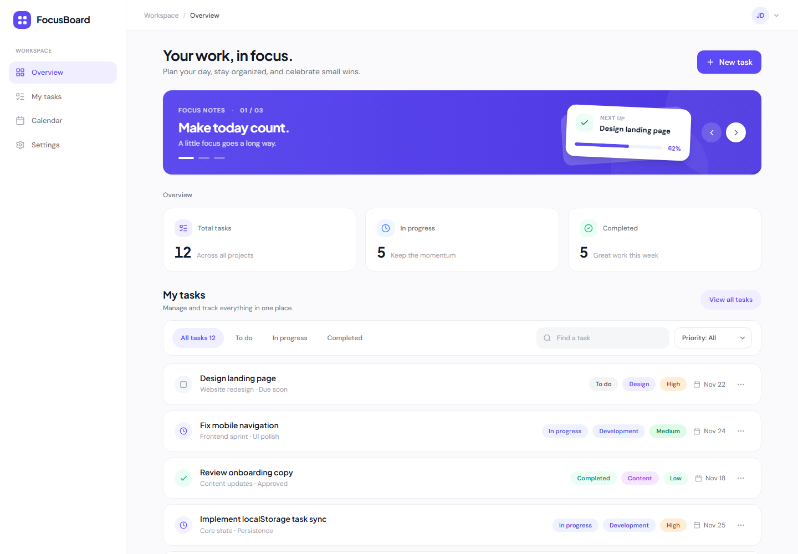
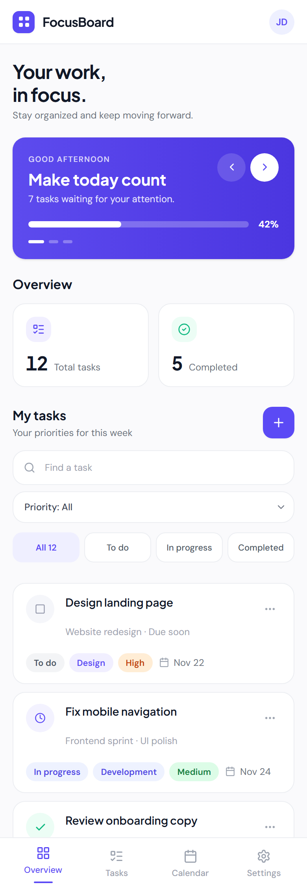

# FocusBoard — Task Management Dashboard

A responsive, single-user task management dashboard built with **React**, **JavaScript**, **Vite**, and **Tailwind CSS**. FocusBoard enables planning daily priorities, tracking task progress across statuses, filtering deliverables in real time, and persisting work locally in the browser without a backend.

---

## Live & Repository Links

- **Hosted Application URL**: https://ais-pre-wxltothfgg6wluuixqqbhj-199273552446.asia-east1.run.app
- **GitHub Repository URL**: `<your-public-github-repo-url>` _(replace with the public repo URL after pushing)_

---

## Screenshots

| Desktop — 1440 px | Mobile — 390 px |
| --- | --- |
|  |  |

---

## Implemented Features

- **Overview Statistics (Derived State)**
  - Dynamically calculates **Total tasks**, **In progress**, **Completed**, and **Completion (%)** (`completed / total * 100`, guarded against zero-task division, powering the mobile Focus Notes completion bar) directly from React task state.
- **Focus Notes Carousel (3 Slides)**
  - Interactive 3-slide Focus Notes banner (`01 / 03`, `02 / 03`, `03 / 03`) featuring circular Previous/Next navigation, clickable slide indicator dashes, tilted task preview cards (`62%`, `67%`, `100%`), and a mobile completion progress banner.
- **Full Task CRUD & Inline Status Updates**
  - **Create Task Modal**: Validates required `Task title` (trimmed, minimum 2 characters) and required `Due date` with inline `role="alert"` error messages, supports `Category`, `Status`, and `Priority` selection, interactive `* Required field` manual note input, Escape-key closing, and backdrop click dismissal.
  - **Edit Task**: Reuses the shared `TaskForm` modal prefilled with the selected task's values while preserving its original unique `id`.
  - **Delete Confirmation**: Prompts an accessible `ConfirmDeleteModal` (`role="alertdialog"`) before removing a task.
  - **Status Updates**: Cycle status directly via the task status icon button or choose `To do`, `In progress`, or `Completed` from the card's `...` action menu to update statistics and counts immediately.
- **Combined Search & Multi-Faceted Filtering**
  - Case-insensitive title search (`SearchBar`, `"Find a task"`).
  - Status filter tabs (`All tasks` / `All`, `To do`, `In progress`, `Completed`).
  - Priority filter dropdown (`Priority: All`, `High`, `Medium`, `Low`) and conditional `Reset` / `View all tasks` actions on mobile, tablet, and desktop.
  - Contextual empty states for both an empty board and zero filter matches.
- **Browser Persistence (`localStorage`)**
  - Reads from `localStorage` key `focusboard_tasks_v4` on initial load before falling back to the 12 default sample tasks (`INITIAL_SAMPLE_TASKS` covering `To do`, `In progress`, and `Completed`), ensuring saved user edits survive page refreshes.
- **Accessibility & Responsive Design**
  - Semantic landmarks (`aside`, `header`, `main`, `nav`, `section`, `article`), explicit labels, keyboard-focusable controls with `focus-visible` rings, `tabular-nums` alignment on metrics, desktop sticky sidebar (`Overview`, `My tasks`, `Calendar`, `Settings`), and mobile bottom navigation bar tested across `390px`, `768px`, and `1440px`.

---

## Tech Stack

- **Framework**: React 19 + JavaScript
- **Build Tool**: Vite
- **Styling**: Tailwind CSS v4 (`@tailwindcss/vite`)
- **Icons**: `lucide-react`
- **Fonts**: Plus Jakarta Sans, DM Sans (self-hosted in `public/fonts/`, no external requests)

---

## Project Structure

```text
├── index.html
├── package.json
├── README.md
├── AI_USAGE.md
├── .gitignore
├── screenshots/
└── src/
    ├── App.jsx                       # Single source of truth state, CRUD handlers, derived stats
    ├── index.css                     # Tailwind CSS v4 import, font tokens & responsive scrollbar rules
    ├── main.jsx                      # React entry point
    ├── assets/
    ├── components/
    │   ├── ConfirmDeleteModal.jsx    # Accessible alertdialog for delete confirmation
    │   ├── FilterTabs.jsx            # Status tabs, embedded search, priority dropdown & reset
    │   ├── FocusNotes.jsx            # 3-slide carousel with circular prev/next & indicator dashes
    │   ├── Header.jsx                # Top breadcrumb header (desktop) & brand bar (mobile)
    │   ├── SearchBar.jsx             # Case-insensitive title search input ("Find a task")
    │   ├── Sidebar.jsx               # Desktop sticky sidebar & mobile bottom navigation bar
    │   ├── StatCard.jsx              # Reusable overview statistics card
    │   ├── TaskCard.jsx              # Responsive task row/card with status toggle & actions menu
    │   ├── TaskForm.jsx              # Shared Create/Edit modal with client-side validation
    │   └── TaskList.jsx              # Task collection container & contextual empty states
    ├── data/
    │   └── sampleTasks.js            # 12 initial sample tasks (To do, In progress, Completed) & 3 Focus Notes slides
    └── hooks/
        └── useLocalStorage.js        # Safe localStorage persistence hook
```

---

## State Management Choice

FocusBoard uses **React Hooks (`useState`, `useMemo`) paired with a custom `useLocalStorage` hook** anchored in `src/App.jsx` as the **single source of truth**:

- **Why React Hooks instead of Redux/Zustand**: For a focused single-user dashboard with one primary entity collection (`Task[]`) and local UI controls, lifting state to `App.jsx` keeps data flow explicit, predictable, and dependency-free without boilerplate stores or action dispatchers.
- **Immutable Mutations**: Every create, edit, status change, and delete operation creates a new array reference (`[newTask, ...prev]`, `prev.map(...)`, `prev.filter(...)`), preventing accidental state mutation.
- **Derived State via `useMemo`**: Overview totals, completion percentage, and combined search/status/priority filtered lists are derived directly from `tasks` so cards, tabs, and metrics stay synchronized automatically.
- **Carousel State**: `FocusNotes.jsx` encapsulates `activeSlideIndex` locally, driving both the active slide content and ARIA tab indicators cleanly.
- **Safe `localStorage` Hydration**: `useLocalStorage` initializes synchronously from `window.localStorage.getItem('focusboard_tasks_v4')` inside a `try/catch` block (verifying `Array.isArray(parsed)`), falling back to `INITIAL_SAMPLE_TASKS` only when no valid saved array exists.

---

## Getting Started

1. **Install dependencies**
   ```bash
   npm install
   ```
2. **Start the development server**
   ```bash
   npm run dev
   ```
   Open `http://localhost:3000` in your browser.
3. **Build for production**
   ```bash
   npm run build
   ```

---

## Deployment

The project builds to a static `dist/` folder and can be hosted on any static host (Vercel, Netlify, or equivalent):

| Setting | Value |
| --- | --- |
| Framework preset | Vite |
| Build command | `npm run build` |
| Output directory | `dist` |
| Install command | `npm install` |

1. Push the repository to GitHub (see `git init` steps below).
2. Import the repository into Vercel or Netlify and apply the settings above.
3. Open the generated HTTPS URL in a private window and verify the dashboard loads, CRUD works, and `localStorage` persists across refreshes.

```bash
git init
git add .
git commit -m "Initial FocusBoard implementation"
git branch -M main
git remote add origin <repository-url>
git push -u origin main
```

---

## Known Limitations & Scope Notes

- **Single-user local storage**: Tasks are stored per browser via `localStorage` (`focusboard_tasks_v4`); there is no backend API, cloud sync, or multi-user authentication.
- **Visual placeholders**: `Calendar` sorts tasks chronologically by due date, while `Settings` in the sidebar/bottom bar and the `JD` user profile avatar in `Header.jsx` remain non-interactive visual placeholders matching the Figma layout without adding out-of-scope screens.
- **In-app confirmations**: Destructive task deletions use the accessible `ConfirmDeleteModal` rather than native `window.confirm` dialogs.
